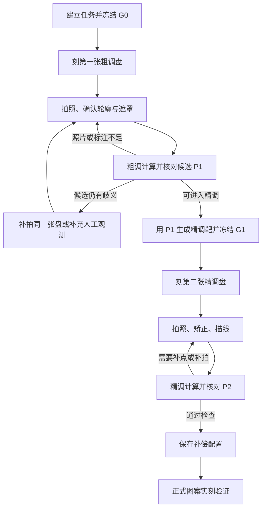

# 12 cm 单层 DVD 通用标定工具：制作指南与原理

> 文档性质：开发设计与实施指南，不是已完成软件的使用说明。  
> 编写日期：2026-11-03。  
> 目标：允许人工确认，以“一张粗调盘 + 一张精调盘”为正常路径，得到可用于 DiscImageStudio 生成图案的补偿配置。  
> 本文提出的标靶、求解策略、文件结构和验收方法，除特别注明外，均是待实现、待验证的设计。

## 1. 应当做成什么工具

工具接收“已知生成条件的标定盘照片”，反推出下一次生成应使用的参数。用户可以人工确认轮廓、反光遮罩、曲线与候选；程序负责坐标恢复、参数计算、歧义诊断和完整记录。

“通用”应当表示：不把某个 MID 的一组半径写死；面对不同介质，使用同一套有边界检查的计算流程。它不表示任意照片、任意刻录异常都一定有解，也不表示所有 DVD 格式共享完全相同的实现。

建议首个正式版本覆盖：

| 项目 | 范围 |
| --- | --- |
| 实体规格 | 标准 12 cm 单层 DVD |
| 第一批支持介质 | DVD-R、DVD+R，分别记录真实可写扇区数 |
| 输入生成参数 | 两个半径、扇区数、通道位长、三个轨距形状系数、方向及图案映射 |
| 输入照片 | 普通相机或手机照片；允许同一张实体盘补拍多张 |
| 人工操作 | 确认实体外缘和真实中心孔；遮掉反光；必要时描线；核对候选 |
| 输出 | 粗调候选、精调配置、叠加报告、可复现的会话与兼容的导入文件 |

DVD±RW 应另做实盘验证后开放；DVD-RAM、双层 DVD、8 cm 小盘、CD、蓝光不纳入首版承诺。标准尺寸也存在公差，60 mm 与 7.5 mm 是照片矫正的名义半径，不是某一张盘的独立精密测量结果。

最终输出首先称为**等效补偿参数**：在约定模型和位长基准下，使后续图案正确呈现的一组参数。不要把它直接宣传成唯一真实物理半径或唯一真实轨距测量。

## 2. 用户流程：两张盘，四个主要步骤

### 2.1 第一张盘：生成粗调标靶

1. 读取介质类别、MID、刻录机和真实可写数据扇区数。
2. 选一个合理初始模型。新建标准任务时可以从恒定轨距开始，但不能替历史盘擅自清零原有系数。
3. 生成粗调图案，同时冻结完整生成快照 `G0`。
4. 在外部刻录软件或 DiscImageStudio 中写入第一张盘，记录实际写入条件。

### 2.2 第一张盘：拍照并计算粗调

1. 导入与 `G0` 对应的照片。
2. 确认外缘、中心孔和照片方向，屏蔽过曝与遮挡。
3. 程序判断观测属于密集环、可追踪边界，或两者混合。
4. 计算候选 `P1`，展示照片与预测图案的对照。
5. 人工核对后，只有通过粗调质量检查的候选才能进入下一步。

粗调不要求把图案完全调直。它的任务是让第二张盘上的径向线有希望连续辨认，并消除会导致精调选错绕行分支的主要误差。

### 2.3 第二张盘：用粗调结果生成精调标靶

1. 使用选定的 `P1` 创建新的圆环与径向线标靶。
2. 冻结这张盘自己的生成快照 `G1`；其中生成模型等于这次实际采用的 `P1`。
3. 写入第二张盘，保存对应记录。

第二张盘同时检查粗调是否有效，并提供精调观测，不固定增加一张“粗调验证盘”。

### 2.4 第二张盘：拍照、精调、保存配置

1. 再次矫正照片，不能直接沿用第一张照片的透视矩阵。
2. 沿同一条清楚的径向线从内到外描点，必要时补充另一条臂或可辨认圆环。
3. 从 `G1` 出发反推 `P2`，检查完整预测曲线及未参与拟合的区域。
4. 保存最终补偿配置、会话、照片和质量报告。
5. 用 `P2` 生成正式图案。第一张使用 `P2` 的成品承担最终实刻效果验证。

第二张盘是在 `P1` 下写入的，因此它能验证 `P1`、反推出 `P2`，却不能证明 `P2` 已经实刻验证。报告必须分开显示这两种状态。



两张是正常路径的目标，不是无条件承诺。失败后优先重拍、修正轮廓、补点或复查生成记录；只有现有实体盘确实缺乏所需信息时，才提出增加标定盘。

## 3. 开发前必须固定的六条规则

1. **每张盘都有不可变的生成快照。** 后续改参数只能创建新记录，不能改变旧照片所对应的生成条件。
2. **照片矫正与刻录补偿分开。** 矫正使用实体轮廓，不使用“径向线应当笔直”作为约束。
3. **正向与反向计算使用同一套几何。** 粗调可以近似求初值，最后评分、精调与导出检查必须回到完整模型。
4. **保留绕行信息与竞争候选。** 不允许每个描点独立加减整圈，把错误模型人为贴到观测上。
5. **能导出不等于能完整表达。** 目标格式缺失位长、方向等字段时，应提供完整配套配置或拒绝不兼容导出。
6. **低残差与参数唯一性分别报告。** 人工可以确认曲线形状，但人工确认不能填补照片中根本不存在的信息。

## 4. 原理：为什么会从大块图案变成很多环

生成器认为数据沿某条螺旋排列；刻录后的数据实际沿另一条螺旋排列。两者在同一个数据位置上的半径与累计角度不同。

DVD 螺旋包含数万圈。很小的轨距或位长差异，沿全盘累积后，也可能让原本的一条径向边界绕盘多圈。照片里看到的密集环或螺旋条纹，是这些边界的观测，不是直接看到了每一条微米尺度的物理轨道。

因此，目测“有 41 个亮环”可以作为累计绕行量的辅助线索，却不能独立确定两个半径、轨距形状和修正方向。亮环数还取决于图案、计数范围、可见性和明暗极性，不能规定一个对所有照片通用的换算倍数。

开发时应先实现完整正向预测：**给定生成模型、候选实际模型和原图，预测照片矫正后应当出现什么几何图案。** 反推只是寻找能解释观测的候选。

## 5. 完整正向模型

以下是工具应实现的数学接口。单位统一使用 mm、rad；仅在输入输出边界转换 nm、μm 和角度。

### 5.1 参数与总轨长

用 `K` 代表一个几何模型：

```text
K = {ri, ro, N, b, c1, c2, c3, direction}

ri、ro：模型内外半径 [mm]
N：该图案所依据的数据扇区总数 [sector]
b：通道位长 [nm/channel bit]
c1、c2、c3：无量纲相对轨距系数
direction：带有明确观察面约定的螺旋方向

B = N × 38688                           [channel bit]
L_K = B × b_K × 10^-6                    [mm]
```

`38688` 是 DiscImageStudio 当前 DVD 模型采用的每扇区通道位数，不是每扇区 2048 字节直接乘 8。实现必须与所对接生成器的编码和数据位置约定一致。[DVD 引擎说明](https://github.com/JiaFeiMiao-K-Cat/DiscImageStudio/blob/main/docs/DVD_ENGINE.md)

新工具的首版应要求整张标靶采用同一段完整、已知的数据映射，不混入改变布局的附带文件。将来支持部分环带、数据混排或非零起始 LBA 时，要把起始位置、有效长度和映射偏移作为显式输入，不能沿用默认零起点。

### 5.2 三次轨距与长度约束

```text
x = (r - ri) / (ro - ri)
q(x) = 1 + c1*x + c2*x^2 + c3*x^3
p_K(r) = p0_K × q(x)                     [mm/turn]

L_K = integral[ri..ro] sqrt(1 + (2πr / p_K(r))^2) dr
```

给定其他参数后，通过这个长度约束求 `p0_K > 0`。`p0` 不是可与 `c1..c3` 任意独立调节的第四个自由系数。采用带括区间的一维求根，积分用有误差控制的数值方法。

必须验证整个生成区间内 `q(x) > 0`：检查端点和 `q'(x)=0` 的区间内部根，不能只抽几个点。模型无效就返回错误，不能把负轨距裁成很小的正数继续算。

### 5.3 从半径到数据进度与累计角度

```text
s_K(r) = integral[ri..r] sqrt(1 + (2πt / p_K(t))^2) dt
u_K(r) = s_K(r) / L_K
θ_K(r) = d × integral[ri..r] 2π / p_K(t) dt
```

`d` 为方向符号。建议内部使用 `x` 向右、`y` 向上的数学坐标，角度逆时针为正；在这个约定下，逆时针 `d=+1`、顺时针 `d=-1`。照片像素通常 `y` 向下，必须在坐标适配层显式转换。

照片镜像、从哪一面看盘和生成器的方向约定同样要显式保存。不能因为某个界面的下拉框写着 CW，就假设它与内部坐标的符号天然一致。方向适配需要用已知合成图和实盘验证。

缓存单调的 `r ↔ u` 查询表及累计角度，反插值用保持单调的方法。缓存精度依据允许的相位误差确定，不依据“半径看起来小数位很多”确定。

可以从目标线宽和采样分辨率反推数值误差预算：若允许的几何误差为 `ε_mm`，在半径 `r` 处对应角误差约为 `ε_mm/r`。积分、反插值和查表误差应明显小于这项预算，并用更高精度计算复核；不能等到图像优化结束后才判断几何近似是否足够。

### 5.4 同一个数据位置如何从源图映射到盘面

记：

- `G`：已经冻结的生成模型，已知。
- `A`：待拟合的实际或等效模型。
- `r`：照片矫正后观测到的物理半径。
- `r_g`：同一数据位置在生成模型中的源半径。
- `β`：该张照片的整体转角。

当两个模型使用相同总通道位数 `B`、相同数据起点时：

```text
u = u_A(r)
r_g = inverse_u_G(u)
Φ(r; G,A) = θ_A(r) - θ_G(r_g)

α_observed(r) = ψ_source(r_g) + Φ(r; G,A) + β
```

`ψ_source` 为源图中所选边界的角度。对于一条径向线，它是常数；对于一般已知图案，由图案本身给出。

也可以写成 `s_G(r_g) = s_A(r) × b_G / b_A`。只有在固定位长相同的情况下，才可直接令两侧轨长相等。

对于源图函数 `F(r_g, ψ)`，几何预测为：

```text
I_geometry(r, α) = F(r_g, wrap(α - β - Φ(r; G,A)))
```

这只是几何图案，不是精确的光学亮度模拟。反光、染料颜色、曝光和相机处理需要另外处理，不能要求预测 PNG 与 RGB 照片逐像素完全相等。

上述公式是工具的核心。密集环、半盘边界、十字线和已知圆环都应复用这个映射，而不是各自维护一套符号不同的公式。

### 5.5 恒定轨距近似：只用于理解与初始化

当两侧 `c1=c2=c3=0`、位长相同，且忽略螺旋径向微小弧长项时：

```text
p_G ≈ π(Ro² - Ri²) / L
p_A ≈ π(ro² - ri²) / L

r_g(r) ≈ sqrt(Ri² + (r² - ri²) × (Ro² - Ri²)/(ro² - ri²))

Φ(r) ≈ d × 2π × [(r-ri)/p_A - (r_g-Ri)/p_G]
```

这能解释为什么修改半径会改变条纹绕行，也能提供快速种子。生成快照带非零系数时，不得把它当作恒定轨距；正式评分也不得停留在这个近似上。

## 6. 可辨识性：为什么参数不应全部自由拟合

单条径向线主要约束的是累计相位形状。固定位长、照片尺度、模型半径和轨距曲线之间可能互相补偿；增加一个自由参数，并不会自动增加一条独立观测。

建议采用以下策略：

1. **常规补偿模式固定 `b_A=b_G` 和真实扇区数。** 拟合半径及必要的轨距形状，输出等效补偿配置。
2. **照片尺度优先由实体外缘和孔缘确定。** 不让模型任意拉伸照片来降低曲线误差。
3. **粗调先低维，精调再按证据增加形状自由度。** 如果低维模型残差呈稳定的系统变化，且增加系数改善了未参与拟合的数据，才升级模型。
4. **已知源半径的圆环作为独立类型观测。** 若能可靠辨认圆环身份，它们提供径向对应关系，而不只是增加同一条线上的点。
5. **检查参数相关性与预测稳定性。** 可能有多组数值不同但预测近似等价的参数；不要把等价参数族误报为明确不同的刻录效果。

圆环约束可写为：

```text
已知第 k 个圆环的源半径 Rg_k
u_G(Rg_k) = u_A(ra_k)
```

`ra_k` 是照片中该环的观测半径。需要确认身份、考虑环宽和径向定位误差。加入圆环后也不能未经分析就声称所有物理量已经唯一确定。[物理模型审计](https://github.com/JiaFeiMiao-K-Cat/DiscImageStudio/blob/main/docs/PHYSICAL_MODEL_AUDIT.md)

## 7. 标靶设计：第一张用什么，第二张用什么

### 7.1 粗调标靶的最低可用方案

居中黑白半盘有两个优点：容易生成，大部分面积用于形成强边界。已有实验工具可以作为这个入口的原型。

局限是明暗极性、方向和整圈分支可能存在歧义。它不应成为“任意盘只需两张”的唯一保证。工具必须保留竞争候选，并允许通过补拍和人工核对继续分析。

### 7.2 正式通用版建议验证非对称粗调标靶

建议在开发阶段比较以下候选，而不是未经实测就更换默认标靶：

| 标靶 | 用途 | 风险 |
| --- | --- | --- |
| 黑白半盘 | 建立最简单基线，验证现有算法 | 对称性和明暗极性带来歧义 |
| 不等宽黑白角区 | 提供更丰富的角向编码，帮助区分镜像和方向 | 多条边界的识别和匹配更复杂 |
| 少量不等间距已知圆环 | 提供源半径对应关系 | 需要可靠识别环的身份，避免与扭曲边界混淆 |

例如可研究四个角区依次占 `50°、80°、100°、130°`、交替黑白的图案。这个例子没有半盘式旋转周期和简单反射对称，但只是候选设计；它的可见度、编码识别和抗反光能力仍需模拟与实盘验证。

不要用微小文字或二维码承担粗调阶段唯一的身份识别。第一张盘可能严重扭曲，细节未必能辨认。标靶 ID 首先依靠软件会话和生成文件关联。

### 7.3 精调标靶

优先复用 DiscImageStudio 的圆环与十字线目标，以便使用其已有标定入口。工具自行设计精调标靶时，应满足：

- 至少一条径向线覆盖大部分绘图环带，宽度适合实际照片分辨率。
- 有对侧或不同角度的径向线，作为未参与拟合的检查数据。
- 圆环的源半径、线宽与身份记录在目标清单中；需要径向约束时才能正确使用。
- 线条之间留出可分离的空间，不用过密网格增加追踪混淆。
- 原图、裁切、缩放、阈值和最终输出使用同一映射。

官方内置标靶的圆环目前主要辅助观察，现有单线反推不自动利用它们的源半径身份。新工具若加入圆环约束，应明确这是新增算法。[辅助标定说明](https://github.com/JiaFeiMiao-K-Cat/DiscImageStudio/blob/main/docs/CALIBRATION.md)

## 8. 照片矫正与观测提取

### 8.1 先保存原图和坐标转换链

导入时统一 EXIF 方向，记录原始尺寸、定向后尺寸、交互缩放和坐标变换。标注点必须绑定到明确的定向后图像坐标，不能只保存浏览器 CSS 像素。

保留原始文件或其内容哈希；会话可以内嵌足够分辨率的副本。减少尺寸时要检查是否把密集条纹降采样到无法分辨。保存操作不应覆盖用户原图。

### 8.2 联合外缘与真实中心孔恢复盘面

建议人工各点 8–16 个初始轮廓点，尽量覆盖整圈，自动边缘吸附只作为辅助。

令 `H` 为图像到盘面毫米坐标的单应变换，可联合最小化：

```text
E_boundary(H) =
  sum_i ρ((norm(H × outer_i) - 60) / σ_outer_i)
  + sum_j ρ((norm(H × hole_j) - 7.5) / σ_hole_j)
```

齐次变换后先除以第三坐标；`ρ` 为稳健损失。整体旋转是不影响矫正的自由度，需要固定一个坐标规范。两组轮廓均需有足够角向覆盖，检查退化、矩阵翻折和合理的映射方向。

使用真实实体边缘，不使用数据区边界、透明夹持区外圈或桌面阴影。透视下椭圆的几何中心一般不等于物理圆心的投影，因此“找到一个椭圆、直接拉圆”不够可靠。

单应模型不消除镜头径向畸变。首版建议避免超广角，要求接近正拍；如果加入镜头畸变参数，应优先依靠相机标定或额外可靠信息，不能靠把刻录曲线拉直来拟合镜头。

### 8.3 在原图上反向采样极坐标

```text
photo → H → physical disc coordinates
(r, α) → H^-1 → oriented source-image pixels
P(r, α, channel) = interpolate(photo, source pixels)
```

从原图直接采样，避免多次旋转、矫正、缩放叠加插值模糊。径向采样间隔要依据原图实际分辨率和条纹频率；插值加密不会恢复原图已经丢失的细节。

### 8.4 遮罩和光照处理

- 自动标出饱和、低对比、遮挡和严重模糊区域，允许人工修改。
- RGB 通道分别评估，不固定某个颜色一定最清楚。
- 在局部区域估计缓慢变化的背景与对比度，保留图案相关变化。
- 对密集与稀疏图案采用不同尺度，不能用同一个高通滤波把大块边界也滤掉。
- 一个局部片段可以有未知明暗极性，但必须在片段内一致并接受跨区域检查。

不要为每个像素或每个半径提供任意独立亮度参数；那会让错误几何也能获得很低的图像误差。

### 8.5 模式分流

| 观测情况 | 主要入口 |
| --- | --- |
| 可以从内到外跟踪同一条边界 | 人工描线或自动追踪后人工确认 |
| 大范围密集条纹，边界难以逐圈追踪 | 局部频率与相位恢复，再用完整图案评分 |
| 部分密集、部分大块，或存在频率过零 | 分片分析，联合求解，保留分支 |
| 没有可信的图案证据 | 返回补拍或检查刻录，不能强行输出参数 |

## 9. 粗调求解：可实施的算法流程

### 9.1 描线入口

人工沿同一条边界从内向外取 20–40 点，按弯曲程度加密，并明确每个点属于哪条连续曲线。

1. 通过 `H` 转换为毫米坐标，得到 `(r_i, α_i)`。
2. 按真实曲线顺序检查径向回退、跳线和重复点。
3. 展开角度，保留累计圈数。相邻采样是否漏圈，要结合完整照片检查，不能仅凭短弧差小于半圈就断言安全。
4. 固定位长和容量，先拟合 `ri、ro、β`，其余形状系数从合理先验出发。
5. 用完整正向模型计算预测线；仍有稳定系统残差时，再逐级放开必要的轨距形状项。
6. 对点间未描出的曲线和其他可见区域评分。

每条完整曲线只允许一个统一整圈偏移；不能让各点分别选最有利的圈数。十字线等重复目标还要保存臂之间的已知角度关系，不能每条臂任意旋转后再声称联合吻合。

### 9.2 密集环入口：分片提取观测，不把单次 FFT 当答案

1. 在多个角度、多个颜色通道提取径向信号。
2. 用滑动窗口频谱、局部相关或小波估计频率和信噪情况，形成局部频率脊线。
3. 按频率变化分片，用带通解析信号、边缘序列等方法提取片段相位。
4. 低对比片段留空；频率接近零或反向的位置切开，保留拼接分支。
5. 联合多角度、已知图案的边界关系和连续性，连接相位片段。
6. 将相位观测转为若干参数种子，再以完整几何及原始可用图像区域重新评分。

解析信号的一侧频谱只能给出一种数学相位约定，不能天然确定真实修正方向；没有编码或跨角度证据时，要保留正反候选。半盘同时存在两条边界，也不能把“检测到一个周期”随意解释成唯一一条物理线。

整盘单一频率方法只适合近似均匀的条纹。通用版必须处理频率随半径变化、部分区域变稀疏、局部过零和反光缺失。

### 9.3 候选生成与搜索

不建议对 `ri、ro、c1、c2、c3` 全部铺极密网格。相位高度敏感，粗网格易漏分支，细网格计算量又会迅速增加。

建议分层实现：

```text
局部频率/连续边界观测
    → 多个相位形状假设
    → 低维参数种子
    → 完整模型局部优化
    → 必要时增加轨距形状自由度
    → 原图、多角度、留出区域联合排序
```

可对参考模型附近的相位灵敏度矩阵做 SVD，优先搜索真正影响观测的少数方向，而不是直接按每个物理参数的数值大小决定步长。参数搜索步长应受“引起多少相位变化”约束。

保留以下离散假设：方向或镜像约定、局部相位符号、缺失段可能漏掉的圈数、图案边界身份。整体增加 `2π` 可被照片转角吸收的候选属于等价关系，不应重复计数；不同径向段之间的圈数差则会改变曲线形状，必须保留并验证。

搜索命中参数范围边界时，按约定扩展范围或返回诊断。不要悄悄裁住半径；范围很宽、分支很多时，也不要把有限多起点搜索称为穷尽解。

### 9.4 目标函数

建议组合三个层次的证据，而不是只优化一个相关系数：

```text
E(A, β, nuisance) =
    λ_phase × E_phase
  + λ_edge  × E_edge
  + λ_image × E_image
  + λ_prior × E_prior
```

- `E_phase`：连续相位或局部频率的一致性，主要帮助确定绕行分支。
- `E_edge`：照片边界与模型边界的距离，使用可解释的毫米或像素单位。
- `E_image`：局部归一化之后的图案一致性，用多角度与留出区域检验。
- `E_prior`：对轮廓不确定量、异常形状系数和不必要复杂度的约束。

各项应按观测噪声尺度归一化。反光片段不能仅因为面积很大就压倒真实边界。允许少量照片几何不确定量时，要由轮廓观测约束，并显示调整量；不能让盘心自由漂移去吸收刻录误差。

### 9.5 粗调结束条件：检查下一张会怎样

选择 `P1` 后，不只重建第一张盘，还要使用每个仍被证据支持的候选 `A_j`，模拟“以 `P1` 生成精调靶”时的边界。

```text
第一张解释：Forward(G0, A_j, coarse_pattern)
下一张预测：Forward(G1=P1, A_j, fine_pattern)
```

进入第二张的依据应包括：

1. 第一张的条纹走向、局部间距和可见边界得到解释。
2. 不同角度、连续径向区间和留出区域没有明显矛盾。
3. 竞争候选对下一张预测的差异已经小到不影响辨认，或有独立证据排除了冲突候选。
4. 预测的精调线在预计拍摄分辨率下可分离、可连续追踪。
5. 最优解未被搜索边界截断，轮廓与遮罩已经确认。

可把预测条纹周期换算为原图像素，检查是否有足够采样；开发初期可采用每周期至少约 6–8 个有效像素作为工程筛查起点，但需要实盘数据验证，不能把它作为已证明的通用阈值。

相关分数第一、平均误差小、或者“环数看起来对”，都不能单独作为通过条件。

## 10. 精调求解：用第二张盘获得最终配置

### 10.1 观测与初始化

精调必须读取第二张的 `G1`，用 `P1` 作为搜索中心，而不是继续拿第一张的 `G0` 解释第二张照片。

推荐沿一条清楚的径向线取 30–40 个点，覆盖靠内、中间和靠外的可见部分；弯曲较快处加密。最低点数与覆盖要求应服从实际模型和所对接软件版本，不能把“点够了”当作曲线可辨识的证明。

预留另一条臂、一个连续径向区间或另一张照片作为检查数据。相邻点高度相关，所以随机留出几个邻近点往往不能有效检查绕圈或外推错误。

### 10.2 先半径，后形状

建议拟合顺序：

```text
G1 与对应照片
  → 检查矫正和角度连续性
  → 先拟合两个半径与照片转角
  → 检查系统残差和参数相关性
  → 有证据时拟合轨距形状
  → 完整曲线与留出数据验证
  → 生成 P2
```

粗调已经需要非零形状项时，精调可以从该模型继续，不必先把它们清零。增加高阶项必须有观测支持；三次模型不是每次都比恒定轨距更可信。

照片可能只支持某几个相位形状方向，而不能稳定地区分所有物理参数。对此应保留最简单的有效模型，或输出预测稳定的等价配置，同时报告相关性。

可选地联合两张盘：分别保留 `G0、G1` 和每张照片自己的 `H、β`，在介质与写入条件足够稳定的前提下约束同一个补偿模型。第一张提供大范围绕行信息，第二张提供清楚的局部曲线；不要把两张生成参数不同的照片直接拼成一条曲线。若两张观测明显冲突，应报告盘间差异或记录问题，而不是强行共享参数。首版可以先用第一张提供候选先验、第二张独立拟合，联合优化作为后续增强。

### 10.3 有物理意义的曲线残差

在已正确展开角度、角差足够小时，可以使用局部法向距离近似：

```text
δα_i = α_observed_i - α_predicted_i
e_normal_i ≈ r_i × δα_i / sqrt(1 + (r_i × α'_observed_i)^2)
```

分母使用观测曲线的局部切线或独立估计，避免一个疯狂绕圈的候选通过增大自身斜率而人为减小误差。大角差或分支未确定时，不应依赖这个局部近似，需要先解决相位连续性或直接计算受约束的曲线距离。

采用 Huber 等稳健损失降低少量误点影响，但同时报告全部有效观测的 RMS、最大偏差、被降权点和遮罩。不能只报告“去掉坏点后的漂亮残差”。现有实现的相关做法可参考 [CalibrationCrossFitter.cs](https://github.com/JiaFeiMiao-K-Cat/DiscImageStudio/blob/main/src/DiscImageStudio.Core/Calibration/CalibrationCrossFitter.cs)。

描点略超出预设生成半径时，不能为了让拟合通过而删除真实观测。若对接模型支持受控延拓，可以在明确的有效域内预测并标注；否则返回“该观测不在模型可解释域”，检查尺度与记录。禁止静默夹到边界，或在三次轨距失去正值后继续积分。

### 10.4 精调通过条件

- 预测线沿整条可见曲线延伸，没有在点与点之间多绕一圈或换臂。
- 留出的臂、连续径向区间或补拍照片与模型基本一致。
- 数值残差相对线宽、照片分辨率和人工定位误差合理。
- 未出现搜索边界截断、明显镜头畸变残差或不可解释的轮廓调整。
- 模型复杂度增加确实改善了检查数据，而不只是训练点。
- 参数在小幅合理轮廓扰动下，预测效果仍稳定。

阈值要用实际样本建立。官方界面已有残差门槛，可在兼容入口遵守；新工具的通过标准还需要结合图像质量、分支一致性和留出验证，不能只照搬一个毫米数。

## 11. 人工确认应该出现在哪里

人工确认是工作流的一部分，不是最后一页“继续使用风险自负”的勾选框。

| 确认点 | 用户看到什么 | 修改后的失效规则 |
| --- | --- | --- |
| 生成记录 | 这张实体盘对应的目标 ID、完整生成参数和图案预览 | 更换记录后，旧拟合全部失效 |
| 外缘与中心孔 | 原图轮廓、矫正预览、轮廓残差 | 修改边界后，矫正和所有派生结果失效 |
| 遮罩与有效区 | 哪些区域因反光、模糊或遮挡被排除 | 修改后重新提取观测、计算与验证 |
| 曲线身份 | 同一条实际边界、点序、可能漏圈位置 | 修改点或身份后，旧曲线拟合失效 |
| 粗调候选 | 第一张重建、第二张预测、竞争候选差异 | 选择变化后，精调生成记录需重新创建 |
| 精调结果 | 完整预测线、留出检查、相关性与质量状态 | 修改观测或模型后，需要重新确认 |

每次确认绑定输入哈希、算法版本和具体候选，不能在输入改变后保留一个脱离对象的 `confirmed=true`。

如果用户无法从现有照片区分两个候选，工具应明确展示“目前仍无法区分”，并提示补拍哪个角度或补哪段曲线。不能让用户凭参数看起来顺眼就承担算法的分支判断。

## 12. 数据格式与追溯

### 12.1 三类数据必须分开

```text
GenerationSnapshot：这张盘当时如何生成，冻结后不可变
Observations：照片、轮廓、遮罩、曲线与圆环，可以追加或修正
FitResult：由指定快照和观测计算的候选及诊断，可重新生成
```

建议用稳定 JSON 作为主记录，照片和图案作为相对路径附件，发布或分享时打成单个任务包。文件名只用于方便查看，真正关联依靠 ID 和内容哈希。

### 12.2 生成快照示例

以下为**新工具拟议 schema 的草稿示例**，不是现有 `.calibration.json`，不能直接导入 DiscImageStudio。这里的容量和初始值仅为示意，必须由实际任务提供。`null` 字段要在完成生成、冻结快照前补齐或明确说明缺失原因。

```json
{
  "schemaVersion": 1,
  "recordType": "generation-snapshot",
  "id": "coarse-disc-0001",
  "state": "draft",
  "disc": {
    "diameterMm": 120,
    "holeDiameterMm": 15,
    "layers": 1,
    "mediaType": "DVD+R",
    "mid": null
  },
  "generated": {
    "innerRadiusMm": 24.0,
    "outerRadiusMm": 58.0,
    "totalSectors": 2295104,
    "channelBitLengthNm": 133.3,
    "pitchLinear": 0.0,
    "pitchQuadratic": 0.0,
    "pitchCubic": 0.0,
    "direction": "cw",
    "directionConvention": "disc-xy-y-up-recording-side",
    "startLba": 0
  },
  "pattern": {
    "id": "coarse-half-v1",
    "file": "assets/coarse.png",
    "sha256": null,
    "mappingVersion": "discimage-adapter-v1",
    "mapping": {
      "imageCentered": true,
      "shortSideEqualsGenerationOuterDiameter": true,
      "cropToGenerationAnnulus": true,
      "binaryInput": true,
      "ditherEnabled": false,
      "threshold": 128
    }
  },
  "generator": {
    "name": "DiscImageStudio",
    "version": null,
    "commit": null,
    "geometryModelVersion": null
  },
  "artifact": {
    "mode": "iso",
    "file": "output/coarse.iso",
    "sha256": null,
    "generationSidecarFile": "output/coarse.iso.json"
  }
}
```

ISO 路径可以在归档时失效，但生成参数和目标图案必须仍可重建；ISO 哈希在实际保存了文件时记录。流式生成没有 ISO 文件时，记录流式任务 ID、同等完整的映射快照和生成器信息。

阈值、灰阶线性化、缩放、透明度、方向等都可能影响输入语义。对接层必须把实际相关选项补全，不能认为上述简化示例已经覆盖所有生成器设置。

### 12.3 观测记录至少包含

- 所属生成快照 ID、内容哈希。
- 照片原始哈希、EXIF 处理、定向后尺寸、附件路径。
- 物理外缘与真实孔缘的像素点、各自定位误差估计。
- 图像到盘面的单应矩阵及坐标约定、矫正算法版本。
- 人工与自动遮罩、有效径向范围、不同通道质量。
- 每条边界的源图身份或未知身份、连续点序和像素坐标。
- 圆环身份、已知源半径、照片观测及其不确定度。
- 人工确认对象、时间和所绑定的输入哈希。

优先保存原始像素标注，再派生毫米坐标。轮廓修改后可以重新投影，不需要伪造“用户重新点击过”的描点。

### 12.4 结果记录至少包含

- 求解所用生成快照、观测哈希、软件与算法版本。
- 所有保留候选及完整精度参数、固定量、搜索范围。
- 照片转角、镜像或方向分支、相位片段拼接关系。
- 拟合误差、留出误差、有效覆盖、降权点与遮罩面积。
- 参数相关性、边界命中、对标注扰动的预测稳定性。
- 第一张重建图、下一张预测图，或精调完整曲线图。
- 质量状态、人工确认状态、导出兼容性。
- 是否已用该结果进行实刻验证，以及对应的验证记录 ID。

输出所有原始双精度数值；界面可以简化显示，但导出不能用界面四舍五入后的字符串。

## 13. 模块划分与技术路线

建议先做离线工具，刻录仍由现有软件承担。这样可以集中验证最难的逆问题，也方便用户保留现有写入流程。

### 13.1 推荐架构

```text
离线标注页面
  ├─ 导入照片、生成记录、已有任务包
  ├─ 轮廓、遮罩、边界与圆环标注
  └─ 导出观测文件

本地计算器
  ├─ 任务格式验证
  ├─ 照片矫正与极坐标采样
  ├─ 粗调求解
  ├─ 精调求解
  └─ 诊断、报告与配置导出

DiscImageStudio 适配层
  ├─ 读取真实生成记录
  ├─ 复用或校验完整轨道几何
  ├─ 创建兼容的精调标靶或会话
  └─ 配置导入与回读核对
```

原型可继续使用 HTML + Python 图像分析。为避免两套几何长期漂移，建议把完整轨道模型放进一个可独立测试的共享库；对接当前 C# 工程时，可通过固定版本的 .NET 命令行适配器调用，之后按部署需求统一运行时。

复用上游源码前检查许可证；把所用提交和构建方式固定下来。不要依赖某台电脑 `%TEMP%/.net/...` 下已解包程序的 DLL 路径作为公共工具运行前提。

### 13.2 建议目录

```text
dvd-calibrator/
  docs/                  原理、坐标约定、格式与验证说明
  schemas/               生成快照、观测、结果、任务包格式
  patterns/              版本化标靶与解析描述
  geometry/              完整正向模型与数值精度控制
  imaging/               定向、双圆矫正、采样、遮罩、观测提取
  coarse/                分支生成、粗调拟合、多角度验证
  fine/                  连续曲线与圆环约束精调
  adapters/              DiscImageStudio 版本兼容
  ui/                    离线标注与候选对照界面
  cli/                   可复现计算入口
  reports/               报告模板
  tests/                 几何、合成逆问题、退化和兼容检查
  fixtures/              合成数据；经许可的实盘样本另行管理
```

### 13.3 建议命令行契约

以下命令是开发目标，并非当前已有可执行程序：

```text
dvd-calibrator inspect       --record generated.json
dvd-calibrator make-target   --task task.json --stage coarse --out new-folder
dvd-calibrator rectify       --observations photo.json --out new-folder
dvd-calibrator fit-coarse    --task task.json --out new-folder
dvd-calibrator make-target   --task task.json --stage fine --candidate ID --out new-folder
dvd-calibrator fit-fine      --task task.json --out new-folder
dvd-calibrator export        --result result.json --format discimage --out new-folder
dvd-calibrator report        --task task.json --out new-folder
```

`make-target` 首版生成 PNG、目标清单和生成参数包；ISO 交给兼容生成器创建，再导回真实生成记录完成快照冻结。只有完整生成适配已实现和验证后，才让同名入口直接生成 ISO。

输出目录默认新建，禁止静默覆盖旧任务；支持取消、错误码和离线运行。正式交付尽量打包运行时，不要求普通用户先解决 Python 路径或桌面 GUI 依赖。

## 14. DiscImageStudio 的兼容方式

### 14.1 读取：优先读“实际生成记录”

优先顺序可以是：同次生成的旁车 JSON / 标靶记录 → 完整任务包 → 工程文件加人工补全。每种格式用独立解析器，校验版本和单位，不用一串宽松默认值吞掉未知字段。

缺少位长、方向、图案映射或非零系数来源时，应显示“记录不完整”，由用户补全并标注为人工提供。不要因为字段缺失就默认为 133.3 nm、CW 和零系数，然后把结果标成完整可追溯。

### 14.2 导出：完整参数不能丢失

当前本机 v1.3.3 的 `.discproj` 几何包含半径、扇区数与三个轨距系数，没有独立保存 DVD 位长和方向的字段。它可以作为工程入口，但不能单独承担新工具的全部结果格式。

建议始终同时导出：

```text
calibration-profile.json     完整补偿配置，作为主数据
candidate.discproj           对目标软件版本兼容时生成
report.html                  参数、证据、限制和应用方式
```

若目标软件入口无法表示某个位长或方向，应拒绝该入口的自动应用，提供需要的替代流程。不能通过导出时悄悄改回默认值来“提高兼容性”。

导出后应通过目标版本的实际加载接口回读，再比较所有可表达参数；不可表达的条件要在报告中明确，且不能把导出成功写成“应用已验证”。

### 14.3 两种产品路径

| 路径 | 优点 | 需要解决的问题 |
| --- | --- | --- |
| 独立工具 + 文件适配 | 容易先交付，可保留现有刻录流程 | 配置传递、版本差异和会话同步 |
| 集成进 DiscImageStudio | 生成快照与应用参数自然衔接 | 上游接口、维护、UI 和完整回归验证 |

建议先完成独立核心与文件契约，再决定是否集成。核心算法不要依赖浏览器按钮或某个界面控件，两个产品路径才能共用。

## 15. 质量状态与失败处理

推荐明确状态，而不是只有“计算成功 / 失败”：

| 状态 | 含义 | 下一步 |
| --- | --- | --- |
| `record-incomplete` | 生成条件不足或格式不兼容 | 补齐记录，暂不生成可直接应用配置 |
| `photo-insufficient` | 模糊、采样不足、遮挡或对比太弱 | 重拍同一张盘或更换照明 |
| `annotation-invalid` | 外缘、孔缘、曲线身份或点序有问题 | 修改标注并重新计算 |
| `candidate-ambiguous` | 存在会影响下一步效果的竞争候选 | 补拍、补观测或展示差异给用户核对 |
| `model-mismatch` | 多区域无法由当前模型一致解释 | 检查记录、矫正、写入情况及模型能力 |
| `coarse-ready` | 通过粗调检查，允许创建精调靶 | 冻结新的 `G1` |
| `fine-ready` | 精调观测与检查数据支持该配置 | 保存 `P2` 并生成正式图案 |

实刻验证是独立字段，例如 `physicalValidation: pending/passed/failed`，不与求解状态混为一谈。

程序应说明具体原因，例如“外侧连续区间的相位与内侧候选冲突”，而不是泛泛显示“参数错误”。评分差距只是排序依据，未用真实数据校准前不能标为“97% 成功率”。

## 16. 验证：怎样证明它比单盘特例更通用

### 16.1 先验证几何，与反推算法分开

必须覆盖：

- `G=A` 时径向映射为恒等、累计相位差为零。
- `r → u → r` 往返一致，起止位置对应正确。
- nm、mm、μm、角度与弧度换算正确。
- 三个系数为零时，与精确恒定轨距实现一致。
- 非零系数时，积分和逆映射与独立高精度实现一致。
- 内部轨距非正、反插值不单调和非法参数能够明确拒绝。
- CW/CCW、像素 y 轴、镜像和观察面转换没有隐式符号变化。
- 图像输出、流式输出或目标适配使用同一份几何语义。

仅用同一套正向实现生成样本再反推，可能把共同错误隐藏起来。至少一部分检查要有独立实现、解析关系或上游真实输出作为参照。

### 16.2 合成逆问题矩阵

不要只测一组接近自己盘片的参数。建立覆盖矩阵：

| 变化项 | 至少覆盖的情形 |
| --- | --- |
| 半径差异 | 正负偏差、相关变化、远离初始搜索中心 |
| 轨距形状 | 生成侧非零、候选侧非零、不同符号与曲率 |
| 位长与方向 | 非默认位长、两种方向、镜像约定 |
| 条纹 | 密集、稀疏、变频、局部过零、缺失多个周期 |
| 摄影 | 正拍、透视、不同分辨率、噪声、压缩和模糊 |
| 光照 | 反光遮挡、通道差异、局部对比翻转 |
| 标注 | 轮廓偏差、漏圈、跳臂、孔缘误选 |
| 信息不足 | 均匀照片、过窄覆盖、全部关键区域被遮挡 |

成功指标首先是恢复正确的可观测映射，并判断能否进入精调；存在等价参数族时，不要求数值恰好等于某组“真值”。同时统计错误放行率和拒绝率，不能只统计成功样本的低残差。

### 16.3 模拟完整两张盘流程

```text
选择隐藏模型 A_true
  → 用 G0 生成第一张的观测
  → 求 P1
  → 用 P1 与 A_true 模拟第二张
  → 求 P2
  → 在未用于标定的正式图案上检验补偿效果
```

第二张样本必须由第一张实际求出的 `P1` 产生，不能预先挑一组理想 `P1` 替代。为了避免“模型自己证明自己”，还应加入未被拟合器完整表达的扰动，例如小幅镜头畸变或局部密度变化，检查它能否识别模型失配。

### 16.4 真实盘盲测

正式宣称通用之前，至少安排 DVD-R 和 DVD+R、多种 MID、多个刻录机与多个批次。记录写入速度、固件、连接方式和拍摄条件，测试时不把该样本最终答案作为算法初值。

主要统计：

- 第一张被判为可进入精调的比例。
- 判为可进入后，第二张实际能连续描线的比例。
- 两张完成的比例、失败原因及补拍次数。
- 错误候选被放行的比例。
- 最终配置用于新图案时的实际效果。
- 同批盘间的重复性，以及换批次或写入条件后的变化。

先用同批、同设备、同写入条件评估，再研究条件变化后的迁移。两张盘法假设两张之间的记录特性足够稳定；如果盘间差异已超过要求，软件不能仅靠精细拟合第一张照片消除这个问题。

## 17. 推荐开发顺序与每阶段交付物

### 阶段 A：先把数据和正向模型做对

交付物：schema、坐标与方向说明、完整几何库、图案正向模拟器、真实生成记录解析器。

完成标准：默认和非零系数、非默认位长、方向、数据进度映射均有独立验证；每张盘的生成条件能够完整冻结和回读。

### 阶段 B：完成可靠的人工照片入口

交付物：照片定向、外缘与孔缘标注、联合矫正、遮罩、极坐标查看、曲线与圆环标注。

完成标准：原图与界面缩放转换一致；边界修改正确使下游结果失效；任务包换目录或换电脑后仍能恢复。

### 阶段 C：先让可追踪边界闭环

交付物：描线粗调与精调、完整曲线叠加、候选比较、留出验证、完整配置导出。

完成标准：不漏圈、不逐点跳分支；不靠任意样条代替物理预测；导出后回读一致。此时还不能宣称覆盖最困难的密集环情况。

### 阶段 D：加入密集环与混合模式

交付物：局部变频分析、相位片段、分支连接、多角度评分、第二张预测与歧义诊断。

完成标准：能处理合成矩阵中的频率变化和缺失区域；对信息不足样本明确拒绝；不把现有单频原型直接包装成正式通用版本。

### 阶段 E：验证标靶与完整两张流程

交付物：经过比较的默认粗调靶、精调靶、任务向导、脱敏样本集和验证报告。

完成标准：真实盲测给出成功率与失败分类，明确哪些条件已经覆盖。未达到时缩小支持声明，而不是删掉失败样本。

### 阶段 F：打包与集成

交付物：离线安装包、软件版本兼容表、用户教程、可导出报告；视需要提交上游集成。

完成标准：新电脑无需临时 DLL 路径；运行不依赖开发机环境；完整流程中的每次确认与配置应用可追溯。

## 18. 已有实验原型能复用什么

本工作区已有的 `dvd-coarse-tool` 可用作原型参考：离线 HTML 标注、JSON 输入、本地 Python 计算、双圆矫正、半盘密集条纹与描线两个入口、报告和候选工程导出。

它目前限定：居中黑白半盘、恒定生成轨距、CW、133.3 nm。密集模式以主频和近似几何产生候选；已有合成样本及少量真实照片核对，未覆盖广泛介质，也未通过本次输出的新候选完成新的实刻验证。

适合复用：

- 标注与报告的基本交互。
- 输入输出分离、保留原图、独立结果目录。
- 双圆矫正原型、极坐标数据组织。
- 正反候选及歧义提示的思路。

需要重做或扩展：

- 恒定轨距近似替换为共享完整几何。
- 完整生成快照和严格版本解析。
- 单一主频扩展为分片、多尺度、变频和混合观测。
- 从两个方向候选扩展为系统的分支保留和验证。
- 标注不确定性、留出检查、跨照片一致性。
- 精调入口、下一张效果预测、目标版本导出适配。
- 跨系统打包、人工交互兼容和真实盘盲测。

已有约 41 个亮环的照片是一条有价值的回归样本，不能成为算法里固定的先验环数；已得到的某组 RITEK 半径也不能成为所有 DVD 的起点答案。

## 19. 开发者实施检查表

- [ ] 首先能解释并复现一张已知条件盘的正向图案。
- [ ] 已知生成参数全部保留；旧照片不会被新参数重新解释。
- [ ] 支持输入侧非零轨距系数，而非只支持输出侧非零。
- [ ] 位长、方向、观察面、图案缩放和数据起点语义明确。
- [ ] 照片坐标、毫米坐标及界面缩放可往返。
- [ ] 不用图案直线约束偷偷修正照片。
- [ ] 能处理密集、稀疏和混合观测，并识别信息不足。
- [ ] 保留有意义的分支，不逐点折回角度抹掉绕行。
- [ ] 粗调检查包含“第二张预测”，不是只看第一张拟合。
- [ ] 精调包含完整曲线和未用于拟合的数据检查。
- [ ] 参数精度、拟合误差和真实物理精度分开表述。
- [ ] 缺失字段和不兼容导出能够阻止静默应用。
- [ ] 结果有可复现报告，所有确认随输入变化正确失效。
- [ ] 两张完成率由实盘盲测支持，不写成无条件保证。

## 20. 参考资料与使用方式

以下为本指南核对所用的上游资料。链接指向可变的 `main`；实际开发应固定具体提交，并为支持的 DiscImageStudio 版本建立兼容测试。

1. [DiscImageStudio 项目](https://github.com/JiaFeiMiao-K-Cat/DiscImageStudio)：生成器及相关实现的上游入口。
2. [DVD_ENGINE.md](https://github.com/JiaFeiMiao-K-Cat/DiscImageStudio/blob/main/docs/DVD_ENGINE.md)：DVD 长度、轨距、图案映射和方向语义。
3. [CALIBRATION.md](https://github.com/JiaFeiMiao-K-Cat/DiscImageStudio/blob/main/docs/CALIBRATION.md)：既有照片矫正、曲线标定与记录机制。
4. [PHYSICAL_MODEL_AUDIT.md](https://github.com/JiaFeiMiao-K-Cat/DiscImageStudio/blob/main/docs/PHYSICAL_MODEL_AUDIT.md)：名义参数、累计相位敏感性和参数可辨识性。
5. [CalibrationCrossFitter.cs](https://github.com/JiaFeiMiao-K-Cat/DiscImageStudio/blob/main/src/DiscImageStudio.Core/Calibration/CalibrationCrossFitter.cs)：连续描线反推的实现参考。

本文可直接作为开发任务的基础：先按阶段 A、B 固定模型和数据，再实现描线闭环，最后攻克密集环与两张盘成功率。它给出的是可检查的实现路线，没有预设任意盘片都必然在两张内收敛。
