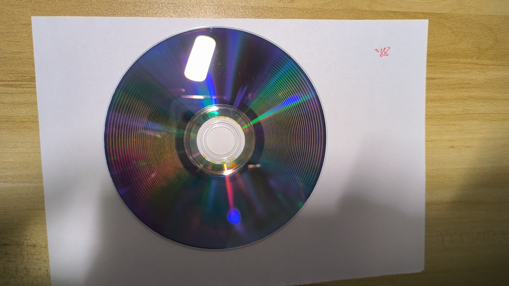
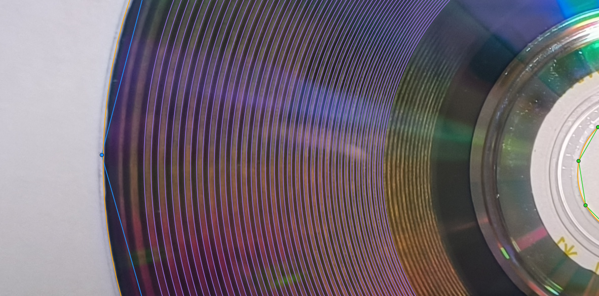
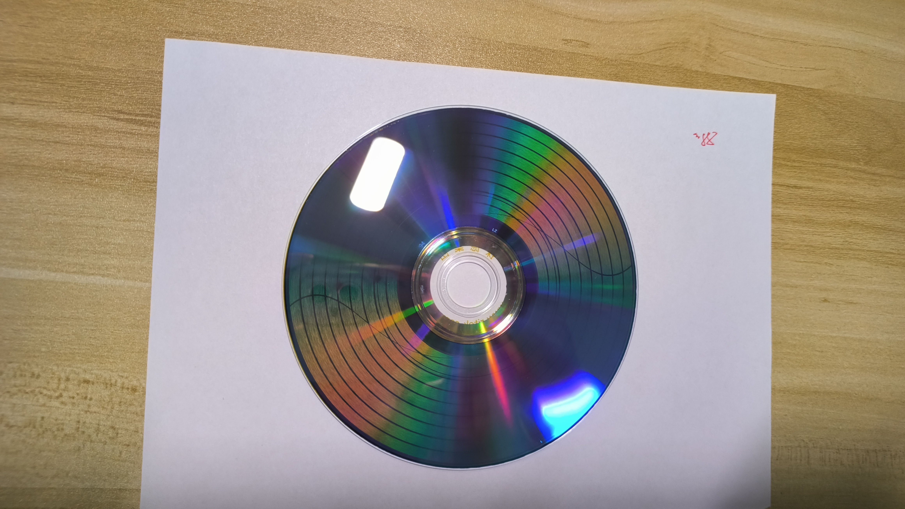
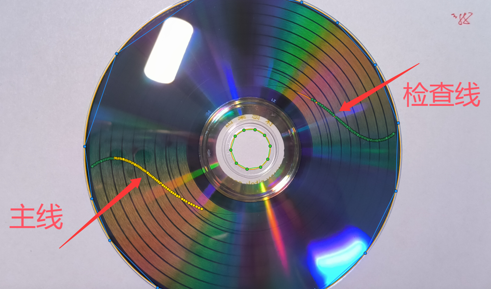
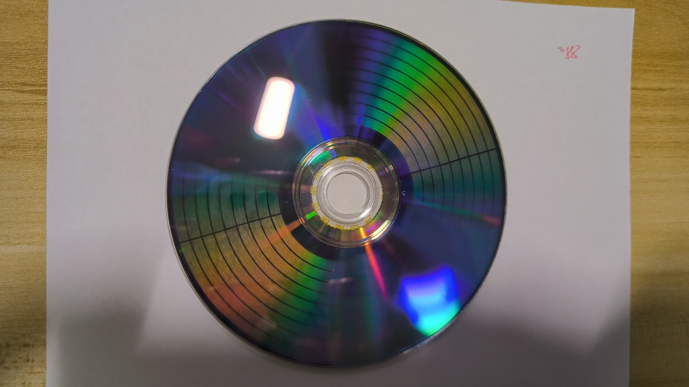

# DVD Calibrator Desktop

从 DVD 记录面的照片估算刻录几何补偿参数，用于 [DiscImageStudio](https://github.com/JiaFeiMiao-K-Cat/DiscImageStudio) 的后续图像刻录。支持 **12 cm 单层 DVD-R 和 DVD+R**，通过 Windows 桌面向导完成照片校正、粗调和精调。

本项目源自我在 DiscImageStudio 分享的两盘标定教程，将黑白半盘粗调和十字标靶精调做成了配套桌面工具。[原始教程 · DiscImageStudio Issue #49](https://github.com/JiaFeiMiao-K-Cat/DiscImageStudio/issues/49)

[GitHub Releases](https://github.com/EternalEve/dvd-calibrator-desktop/releases) · [分步教程](docs/guided-workflow.md) · [更新记录](CHANGELOG.md)

## 开始使用

在 Windows x64 上，完整解压 Releases 中的 `DvdCalibrator-*-win-x64.zip`，双击 `启动 DVD Calibrator.cmd`。便携包自带 .NET 运行时。若 Releases 暂无便携包，可按下方说明从源码运行。

想先体验精调，可以在解压目录用 PowerShell 启动合成示例。示例直接打开第 7 步，已有照片和描点。点击“拟合描线”，确认候选曲线后，到第 8 步查看结果。

```powershell
& '.\启动 DVD Calibrator.cmd' --two-disc-demo
```

## 实盘标定

准备两张同类型的空白盘、刻录机和相机。DiscImageStudio 生成 ISO，刻录软件写盘，DVD Calibrator 分析照片并给出补偿参数。

1. **粗调。** 在向导第 1 步保存黑白标定图，用 DiscImageStudio 生成镜像并刻录。将 ISO 同目录的 `.iso.json` 和记录面照片交给向导，按提示标注盘边与中心孔，再运行密环分析。
2. **精调。** 把粗调参数填入 DiscImageStudio 的“工程设置”，使用其自带的辅助标定图案制作第二张盘。回到向导，导入同名的 `.calibration.json` 和照片，校正后点击“自动描线并拟合”，检查并确认曲线。
3. **应用补偿。** 第 8 步检查通过后，复制补偿参数到 DiscImageStudio，再导入正式图片。中途可用“保存进度”保存任务，下次从“打开任务”继续。

手上已有一组参数时，可从“使用已有参数”进入单盘精调。完整操作见[分步教程](docs/guided-workflow.md)，程序右上角也可打开离线教程。

当前已完成软件回归和模拟验证，实盘标定效果仍待验证。

## 从源码运行

在 Windows 上安装 [.NET SDK 10.0.203](https://dotnet.microsoft.com/download/dotnet/10.0)（支持同一补丁系列），从仓库根目录启动桌面版。

```powershell
dotnet run --project src/DvdCalibrator.App -c Release
```

命令行版可用于检查生成记录、拟合描线和导出补偿配置。源码运行 `dotnet run --project src/DvdCalibrator.Cli -c Release -- --help`，便携版运行 `app/DvdCalibrator.Cli.exe --help`。

运行 `./tools/Test.ps1` 可执行完整回归。源码打包见[便携交付说明](docs/portable-validation.md)。

## 文档与反馈

- [两盘工作流](docs/two-disc-workflow.md)和[照片标注](docs/photo-workflow.md)
- [架构与坐标约定](docs/architecture.md)和[数据契约](docs/data-contracts.md)
- [GitHub Issues](https://github.com/EternalEve/dvd-calibrator-desktop/issues)

## 实机测试







## 许可证

[GPL-3.0-or-later](LICENSE)。依赖和上游代码的授权见[第三方声明](THIRD-PARTY-NOTICES.md)。
